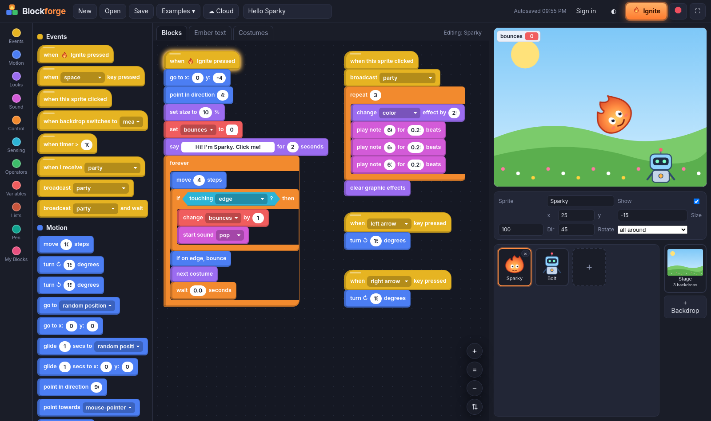
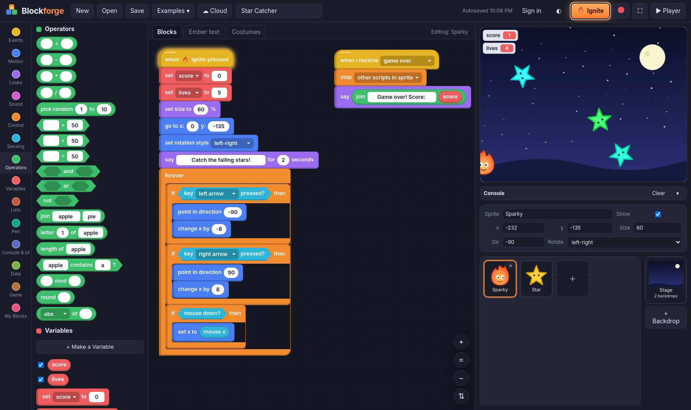
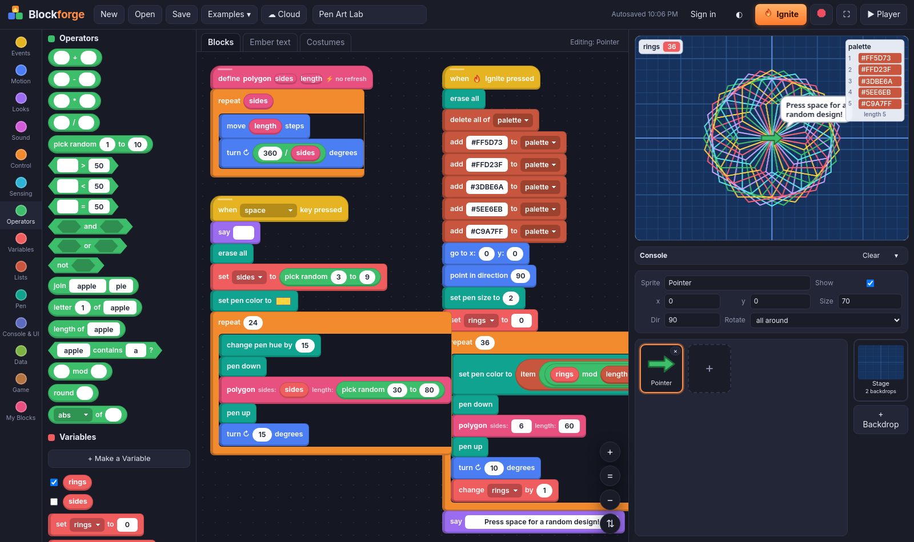
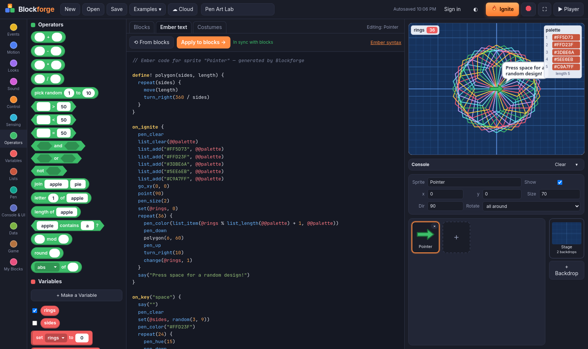
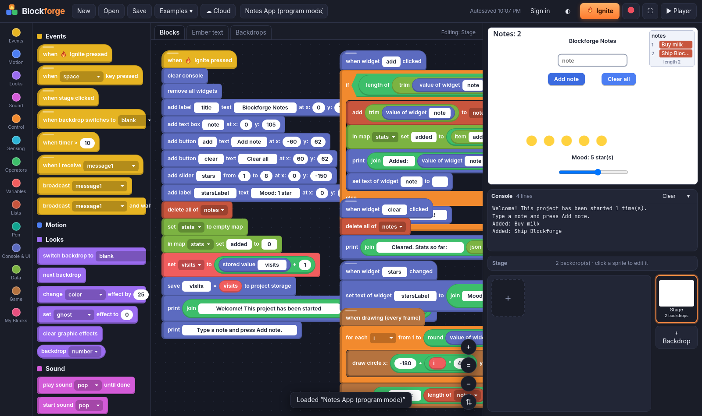
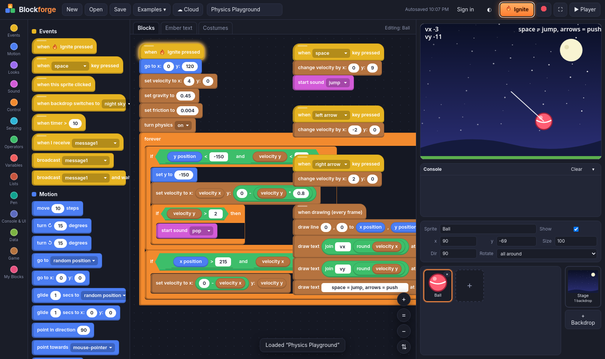
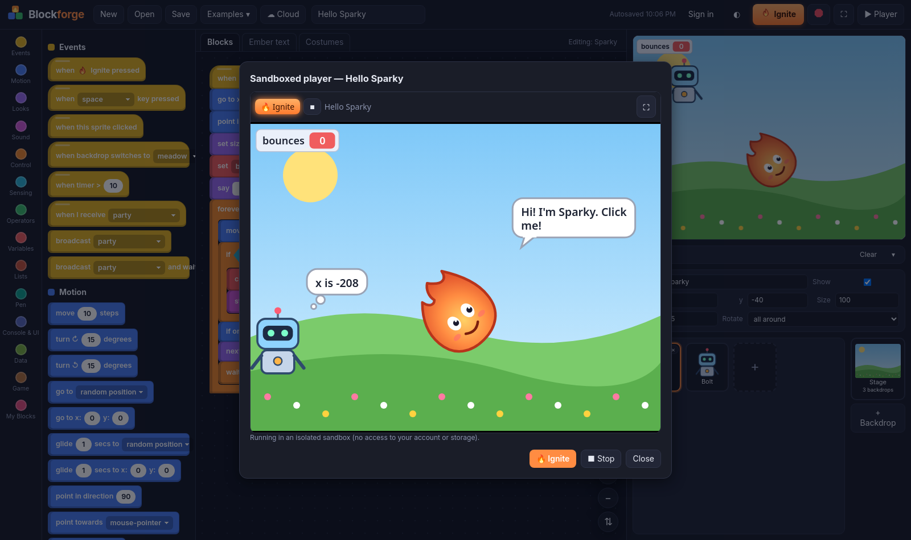
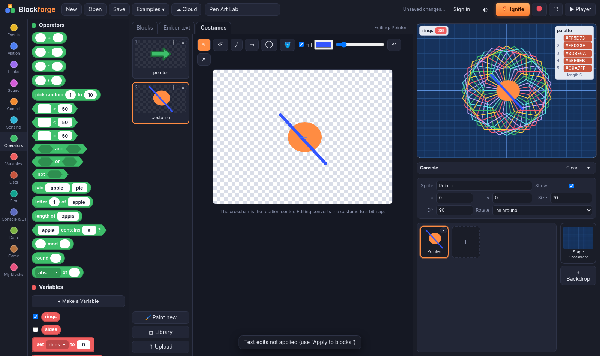
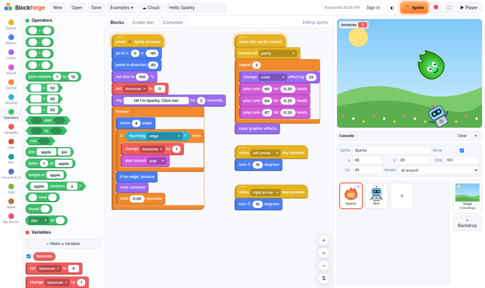

<p align="center"></p>

# Blockforge

**A block-based visual programming studio with its own language, Ember.** Snap blocks together to build games, animations *and* regular programs, then flip to the text view and keep going in code. The blocks and the text are two views of the same program.

🔥 **Live:** https://blocks.0x11a.org



## Why Blockforge?

Blockforge takes the "drag blocks, press go" idea from beginner-friendly block editors and pushes it toward a real development tool:

- **Two-way text language (Ember).** Every block has an exact text form. Edit either view and apply. Both views parse to the **same tree**, which runs on the **same interpreter**. Nothing is ever compiled to JavaScript.
- **Games *and* programs.** Physics, a camera, a per-frame draw event and rooms for games. A console, UI widgets (buttons, labels, text boxes, sliders), maps, JSON and project storage for apps.
- **Safe by design.** Shared projects run in a sandboxed, opaque-origin iframe with a strict CSP and no network access. The interpreter enforces step budgets, recursion limits, memory caps and a watchdog.
- **Original look.** Our own block style, palette, mascot (Sparky the ember spirit), robot friend Bolt and every other character, backdrop and icon were hand-drawn as SVG for this project.

## Features

| | |
|---|---|
| **Block editor** | Palette with 14 categories, drag & drop, vertical snapping, nested C-blocks, reporters/booleans that plug into inputs, drag-to-palette delete, duplicate/delete context menu, zoom, clean-up, click-to-run with running glow |
| **Language** | Events (Ignite, keys, clicks, broadcasts, timers, every-N-seconds), Motion, Looks, Sound (WebAudio synth, no audio files), Control (loops, if/else, clones, stop), Sensing (pixel-accurate touching, touching color, ask/answer), Operators, Variables, Lists, Pen, **My Blocks** (custom blocks with inputs + run-without-refresh) |
| **Program mode** | Console (`print`), UI widgets with click/change events, booleans, text functions, maps, JSON, per-project key/value storage |
| **Game toolkit** | Velocity, gravity, friction, a draw event (`draw_rect/circle/line/text`), camera, rooms |
| **Stage** | 480×360 canvas, multiple sprites, costumes, backdrops, layers, effects, speech/thought bubbles, draggable sprites, variable & list monitors, fullscreen mode |
| **Art tools** | Costume paint editor (brush, eraser, line, rect, ellipse, fill, undo) plus an original sprite & backdrop library and image upload |
| **Ember text view** | Syntax highlighting, error messages with line numbers, apply to blocks |
| **Projects** | Autosave to localStorage, download/open `.bforge.json`, 5 example projects, optional cloud accounts, saving & share links |
| **UI** | Polished dark & light themes |

## Screenshots

| | |
|---|---|
|  Clones, keys, score & lives |  Pen art with a custom block |
|  Ember text view |  Program mode: widgets + console |
|  Physics & draw event |  Sandboxed player |
|  Costume paint editor |  Light theme |

## Ember in 30 seconds

```
on_ignite {
  set(@score, 0)
  forever {
    move(5)
    bounce
    if touching("Star") {
      change(@score, 1)
      play_sound("coin")
    }
  }
}

define! polygon(sides, length) {
  repeat(sides) {
    move(length)
    turn_right(360 / sides)
  }
}
```

- **Language reference:** [docs/EMBER.md](docs/EMBER.md)
- **Every block with its Ember form:** [docs/BLOCKS.md](docs/BLOCKS.md)
- **Security model:** [docs/SECURITY.md](docs/SECURITY.md)

## Quick start (local)

Requires **Node 22+**.

```bash
npm install
npm run build          # -> dist/ (fully static: editor + sandboxed player in dist/player/)
npx vite preview       # http://localhost:4173
```

For development use `npm run dev` (hot reload). The sandboxed player is built during `npm run build`, so use `build` + `preview` to try the ▶ Player button.

### Optional: cloud accounts (server)

The editor works entirely without a server. The optional API in `server/` adds accounts, cloud saves and share links (Node 22, `better-sqlite3` with prebuilt binaries, pure-JS `bcryptjs`, so no compiler is needed).

```bash
cd server && npm install --omit=dev
# Local http:// development: BLOCKS_DEV=1 uses a non-__Host- cookie without Secure
BLOCKS_DEV=1 ALLOWED_ORIGIN=http://localhost:4173 DB_PATH=./data/dev.db node index.js   # listens on 127.0.0.1:8795
```

`vite preview` and `vite dev` proxy `/api` to `127.0.0.1:8795` (override with `BLOCKS_API=http://host:port`).

API (all JSON, all under `/api/`): `POST /api/signup`, `POST /api/login`, `POST /api/logout`, `GET /api/me`, `GET|POST /api/projects`, `GET|PUT|DELETE /api/projects/:id`, `POST /api/projects/:id/share`, `GET /api/shared/:id`.

### Tests

```bash
npm test               # Ember round-trip, limits/parser guards, server integration tests
npm run e2e            # Playwright end-to-end (needs `npx playwright install chromium` and a running preview on :5180)
```

## Self-hosting

1. `npm ci && npm run build` with your domains:
   ```bash
   VITE_RUNTIME_URL=https://run.example.com/ PLAYER_EDITOR_ORIGINS=https://editor.example.com npm run build
   ```
2. Copy `dist/` to your web root (e.g. `/var/www/blocks`). Serve `dist/player/` from a **separate origin** (e.g. `run.example.com`) with the strict CSP header from [`deploy/nginx.example.conf`](deploy/nginx.example.conf). `frame-ancestors` must be sent as an HTTP header because it is ignored in `<meta>`.
3. Optional API: copy the repo to `/opt/blocks`, run `npm ci --omit=dev` in `server/`, and install [`deploy/blocks.service.example`](deploy/blocks.service.example) (systemd, read-only app dir, only `/var/lib/blocks` writable).
4. Put nginx in front using [`deploy/nginx.example.conf`](deploy/nginx.example.conf): exact-match `location = /api/login` and `= /api/signup` with a strict rate limit, plus `/api/` with a general one.

In production the session cookie is `__Host-blocks_session` (Secure, HttpOnly, SameSite=Strict, Path=/, no Domain), so the site must be served over HTTPS.

## Project layout

```
index.html, src/        editor (vanilla JS + Vite)
  blocks.js             block definitions (shapes, categories, Ember keywords)
  runtime.js            tree-walking interpreter, scheduler, guards
  ember.js              Ember parser/printer (text <-> block tree)
  limits.js             shared safety limits (client, player, server)
  workspace.js          block rendering and drag & drop
  player.js             sandboxed player (built as a classic script)
  art.js                original SVG characters, backdrops, logo
player/index.html       sandboxed player page (strict CSP)
server/                 optional Cloud API
docs/                   language reference, block reference, security notes
deploy/                 example nginx + systemd configs (placeholders)
tests/                  unit + Playwright tests
```

## Credits

Blockforge was designed and built by **Programmer**, Mikael's AI coding assistant, for **Mikael Nurminen** ([@mixutin](https://github.com/mixutin)). It's live at **https://blocks.0x11a.org**.

All code, block designs, characters (Sparky, Bolt and friends), backdrops, icons and the logo are original work made for this project. Blockforge is inspired by the general idea of block-based programming but contains no code or assets from any other block editor.

## License

[MIT](LICENSE) © 2026 Mikael Nurminen
